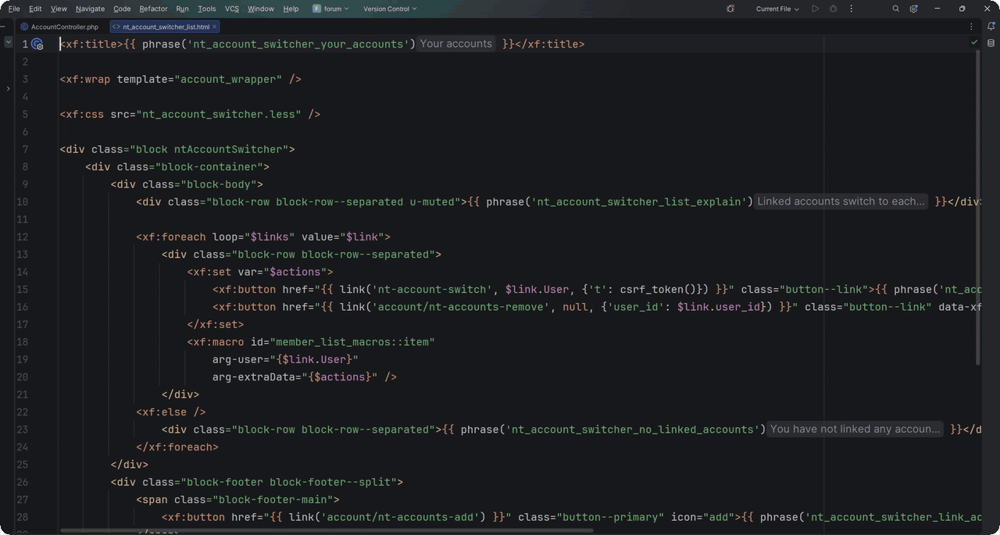
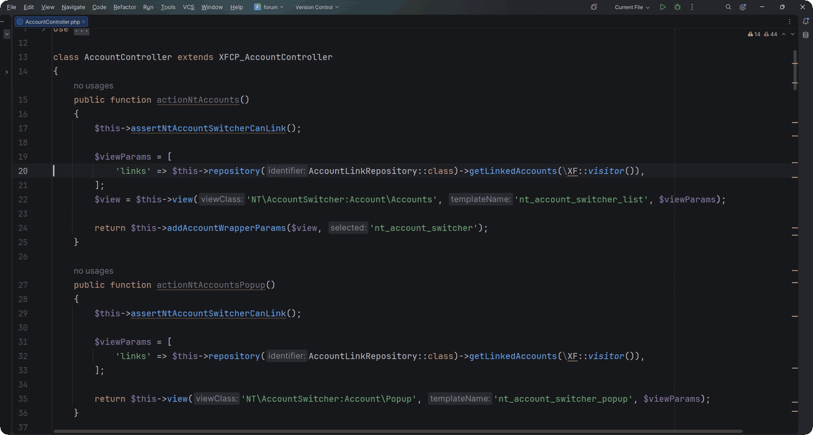
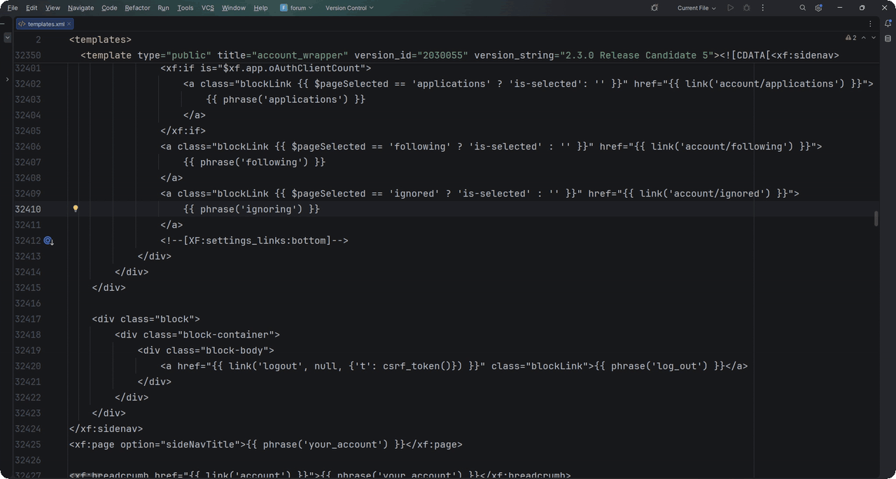
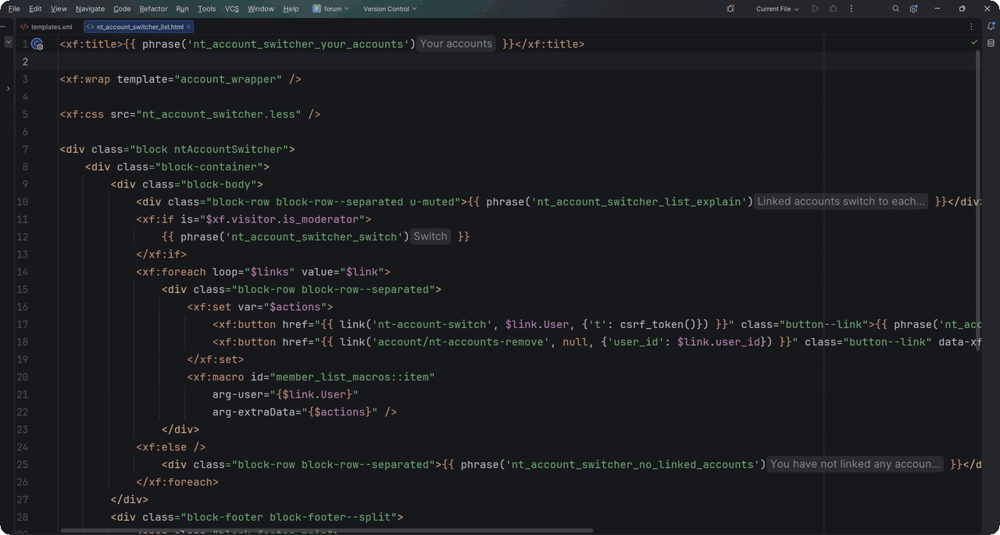

<div align="center">


# XenForo Tools

A PhpStorm plugin for XenForo 2 add-on and style development

[](https://www.jetbrains.com/phpstorm/)
[](https://xenforo.com)
[](https://github.com/mityakuss-pixel/nt-xenforo-phpstorm/releases/latest)
[](https://github.com/mityakuss-pixel/nt-xenforo-phpstorm/releases)
[](LICENSE)

[Русский](README.md) · **English**

<br>



</div>

<br>

Out of the box, PhpStorm treats a XenForo template as plain HTML: it reports `{{ link(…) }}` in attributes and `<xf:if>` tags as errors, breaks the indentation when formatting and knows nothing about phrases, macros or `XFCP_` classes. XenForo Tools teaches the IDE the XenForo template language and connects templates, phrases, template modifications and add-on PHP code with each other.

Every name comes from the files of your forum: the `_output` folders of your add-ons, `_data` of XenForo and installed add-ons, and the PHP classes. Completion therefore matches the installed XenForo version, and third-party add-ons show up just like the core. Template parsing is checked against all 1,198 templates of XenForo 2.3.

## Templates

- **Syntax without false errors.** `<xf:…>` tags, `{{ … }}` expressions and `{$…}` variables are highlighted on top of HTML. HTML, CSS and JavaScript inside a template keep working as usual; code in `<xf:js>` is parsed as JavaScript and code in `<xf:css>` as LESS.
- **Completion.** Tags with their required attributes, macro arguments, functions and filters, `$xf.visitor` fields and methods, `$xf.options` with nested keys. Functions and filters that your add-ons register with `addFunction()` and `addFilter()` are listed too.
- **<kbd>Ctrl</kbd>+Click** opens templates, macros, phrases, routes, permissions, style properties, `data-xf-click` and `data-xf-init` handlers, tag classes and entity fields. The full list is below.
- **Variables from controllers.** The plugin finds `$this->view(…, 'template', $viewParams)` and knows the type of every parameter: `{$thread.` lists the fields of `XF\Entity\Thread`. An icon on the first line of the template opens the controller, and <kbd>Ctrl</kbd>+Click on a variable without `<xf:set>` opens its key in `view()`.
- **Documentation.** <kbd>Ctrl</kbd>+<kbd>Q</kbd> shows the phrase text, the option description, tag attributes and function parameters. The phrase text is also shown in gray after `{{ phrase('…') }}`.
- **Formatting.** <kbd>Ctrl</kbd>+<kbd>Alt</kbd>+<kbd>L</kbd> indents with tabs, like XenForo's own templates. `<xf:else />` lines up with its `<xf:if>` as you type, and attributes are aligned according to the HTML code style.
- **Sticky lines.** While you scroll, the parent tags stay at the top of the editor: `<xf:if>`, `<xf:foreach>` and the HTML around them, the same way PHP keeps the class and method. The breadcrumbs at the bottom of the editor show both kinds of tags too.
- **Compile errors.** Unclosed and mismatched tags, `<xf:else />` outside `<xf:if>`, unknown tags, unfinished expressions and `phrase($name)` with a name taken from a variable are underlined right away, before you open the forum. For `phrase($name)`, <kbd>Alt</kbd>+<kbd>Enter</kbd> replaces the call with `phrase_dynamic($name)`.
- **Unknown macros.** When the template is found but has no macro with that name, `<xf:macro id="template::macro">` and `call_macro()` get a weak warning. Templates missing from the project and templates that a template modification may add the macro to are not checked.
- **Admin templates outside the control panel.** XenForo compiles admin templates only for the admin control panel, so `<xf:include template="admin:…">` in `public` and `email` templates is underlined.
- **Typing assistance.** `{{` adds the closing ` }}`, `>` in `<xf:foreach …>` adds the closing tag, and <kbd>Ctrl</kbd>+<kbd>/</kbd> wraps the selection in `<xf:comment>`. Renaming any paired `<xf:…>` tag, for example `<xf:select>` to `<xf:radio>`, renames the closing tag too, as with HTML, and the other way round.

<details>
<summary><b>Where completion and navigation work</b></summary>
<br>

| Where | What opens |
|---|---|
| `<xf:include template="…">`, `<xf:wrap>`, `<xf:extends>` | template |
| `<xf:macro id="template::macro">`, `extends="…"` of a macro | template and the macro in it; a macro call also completes its `arg-…` arguments |
| `<xf:extension id="…">`, `<xf:extensionvalue>` | extension in this template or in a parent along the `<xf:extends>` chain |
| `<xf:css src="….less">` | style template |
| `<xf:js src="…">`, `dev="…"`, `prod="…"` | file in `js/`; with `addon="…"` the add-on's `_files/js` is checked first, the same way XenForo looks it up |
| `<xf:widgetpos id="…">` | widget position |
| `<xf:callback class="…" method="…">` | PHP class and method |
| `data-xf-init="tooltip"`, `data-xf-click="overlay"` and any other `data-xf-<event>` | handler registered with `XF.Element.register` or `XF.Event.register` |
| `phrase('…')` | phrase, with its text in the completion list |
| `link('…')`, `link_type('…', '…')` | route |
| `property('…')` | style property |
| `$xf.visitor.hasPermission('forum', '…')` | permission in `_output/permissions` or `permissions.xml` |
| `$xf.visitor.username`, `$xf.visitor.canSearch()` | PHP class field or method |
| `$xf.options.boardTitle` | option in `options.xml` or `_output/options` |
| `<xf:avatar>`, `<xf:foreach>` and other tags | tag class in `XF\Template\Compiler\Tag` or in add-on code |
| `\|escape`, `demo_badge(…)` | `Templater` method or the add-on code that registers the function |
| `$hasBadges` in `is="…"` and `{$…}` | `<xf:set var="…">`, `value`, `key` or `i` of `<xf:foreach>`, a macro `arg-…`, or the array key in the controller's `view()` |

Phrase name modifiers such as `phrase('user_name:')` are stripped the same way `XF\Language` does, so the phrase itself opens. Renaming a template file updates the `template="…"` references to it. The **Structure** tool window shows `<xf:…>` tags as a tree and macros as `xf:macro#name`.

</details>

<details>
<summary><b>LESS and CSS</b></summary>
<br>

`.less` and `.css` templates from `_output/templates` open as XenForo templates on top of LESS and CSS: `<xf:if>`, `<xf:foreach>` and `{$…}` inside styles don't break parsing.

Every stylesheet gets what `XF\CssRenderer` adds to it: `public:setup.less` with its nested templates, `<prefix>_prepend.less` and everything included with `{{ include('…') }}`, `<xf:include>` and `@import`. Variables and mixins from them, `@xf-…` and `.xf-…()` from style properties and `@fa-var-…` are not reported as undeclared. <kbd>Ctrl</kbd>+Click on a variable or mixin opens its declaration.

</details>

## Add-on PHP code

<div align="center">

</div>

- **`XFCP_…` classes are no longer red.** The plugin takes extensions from `_output/class_extensions`, `_data/class_extensions.xml` and the classes themselves and tells PhpStorm which class each of them extends. Parent method completion, `parent::` and <kbd>Ctrl</kbd>+<kbd>O</kbd> work. The stub with these classes is kept in the PhpStorm system folder; nothing is written to the project.
- **Short class names.** `'XF:User'` in `finder()`, `em()->find()`, `repository()`, `service()`, `plugin()`, `enqueue()` and other factories is completed and opens the class that `XF::stringToClass` would load. <kbd>Alt</kbd>+<kbd>Enter</kbd> replaces the short name with the class, such as `\XF\Entity\User::class`, wherever XenForo 2.3 itself passes a class. `view()`, `behaviors` and `shortName` keep short names, as in the core.
- **Entity columns.** `where('…')`, `order('…')`, `with('…')` and `$entity->get('…')` complete columns, relations and getters, including paths like `User.username` and columns added by extensions and `entity_structure` listeners.
- **XenForo names in strings.** `\XF::phrase('…')`, `$this->view(…, '…')`, `renderTemplate('public:…')`, `buildLink('…')` and `hasPermission('…', '…')` complete and open phrases, templates, macros, routes and permissions. The phrase text is shown in gray. An `admin:` template rendered from a `Pub` or `Api` controller or view is underlined.
- **App container.** <kbd>Ctrl</kbd>+Click on a key in `\XF::app()->container('…')`, `$app['…']` and `$container['…']` opens the place where the key is defined, in XenForo itself or in add-on code such as an `app_setup` listener.
- **Class extensions.** Right-click a class of XenForo or another add-on and choose **Extend Class in XenForo Add-on…** to create the extension and register it. The same item is in the context menu of the class file in the Project view and under <kbd>Alt</kbd>+<kbd>Enter</kbd>.
- **Controller reply check.** <kbd>Alt</kbd>+<kbd>Enter</kbd> on `return parent::actionIndex($params);` wraps the reply in a `$reply instanceof \XF\Mvc\Reply\View` check.
- **Add-on PHP version.** When `require.php` in `addon.json` differs from the project PHP language level, a banner above the add-on's PHP files offers to switch. PhpStorm keeps one language level per project, so the switch applies to the whole project. The same action is in the add-on menu, and **Settings → PHP → XenForo** can switch the level automatically when you open a file of the add-on.
- **Add-on scopes.** Every add-on with `_output` gets a ready-made "XenForo: Vendor/AddOn" scope for Find in Files, file colors and inspection settings.
- **Setup.php.** `installStep1()`, `upgrade1000170Step2()` and `uninstallStep1()` get a run icon that executes the single step with `xf-addon:install-step`, `upgrade-step` or `uninstall-step`.
- **JSON in `_output`.** Classes and methods in class extensions, code event listeners, routes, cron entries, widget definitions and options open on <kbd>Ctrl</kbd>+Click. `addon.json` and `build.json` are validated against a schema, so an unknown key or a missing `version_id` is underlined.

## Template modifications

<div align="center">

</div>

- Select a fragment in a template or in XenForo's `templates.xml` and choose **Create XenForo Template Modification…** in the context menu. The plugin fills in the template, the add-on and `find`, checks how many times the fragment occurs in the template and creates the modification with `xf-make:template-modification`.
- An icon in the gutter of a template and of `templates.xml` shows which modifications of which add-ons change the line. Clicking it opens the modification.
- When `find` no longer occurs in the template, for example after a XenForo update, the modification JSON is underlined.

## Phrases

<div align="center">

</div>

- A phrase that exists neither in `_output` nor in `_data` is underlined in template `phrase('…')` calls and in PHP `\XF::phrase('…')`. <kbd>Alt</kbd>+<kbd>Enter</kbd> creates it in the add-on you pick.
- <kbd>Alt</kbd>+<kbd>Enter</kbd> on template text replaces it with `{{ phrase('…') }}` and creates the phrase. The title is built from the add-on prefix and the text; Cyrillic text is transliterated.

The check turns on when the project has the core phrases in `src/addons/XF/_data/phrases.xml`.

## Add-on commands

Right-click an add-on folder or any file inside it to open the **XenForo: Vendor/AddOn** menu. The same menu is in the editor tab menu and under **Tools**.

| Item | Command |
|---|---|
| Build Release | `xf-addon:build-release`; a notification links to the ZIP when it is ready |
| Bump Version… | `xf-addon:bump-version`; `version_id` is calculated from the version string, including `RC 2` and `Patch 1` |
| Export / Import Development Output | `xf-dev:export` and `xf-dev:import` for this add-on |
| Export _data XML | `xf-addon:export` |
| Sync addon.json to Database | `xf-addon:sync-json` |
| XenForo Artifact (xf-make)… | an entity, controller, route, template, listener or anything else your version's `xf-make` can create. Also in **File → New** |
| Extend Class… | `xf-make:extension` |
| Lint Templates | `xf-dev:lint-templates`; errors in the output link to the template and line |
| Find Unused Phrases | `xf-dev:unused-phrase-finder` |
| Update Entity @property Docblocks | `xf-dev:entity-class-properties` for every entity of the add-on, or only for the entity whose file was right-clicked |
| Check Classes Load | `xf-dev:class-lint` |
| Generate .phpstorm.meta.php | `xf-dev:generate-phpstorm-meta` |
| Generate Options Stub | `xf-dev:generate-options-stub` |
| Run cmd.php Command… | any `cmd.php` command; the last one is remembered |

Items whose command your XenForo version lacks are hidden. XenForo 2.2 has no `xf-make` commands, so there the plugin writes the file to `_output` and runs the `xf-dev:import-…` import itself.

The output goes to the **Run** tool window, where a command can be stopped or run again. Commands run with the project PHP interpreter. If the forum needs a different PHP version, pick it in **Settings → PHP → XenForo**; remote interpreters work too: Docker, WSL, SSH. The same page takes the forum folder with `cmd.php` for add-ons kept outside the forum and linked with a symlink.

## Installation

PhpStorm 2026.2 or later is required.

1. Download `nt-xenforo-phpstorm-<version>.zip` from the [releases page](https://github.com/mityakuss-pixel/nt-xenforo-phpstorm/releases/latest). Do not unpack it.
2. Open **Settings → Plugins** (<kbd>Ctrl</kbd>+<kbd>Alt</kbd>+<kbd>S</kbd>, or <kbd>⌘</kbd>+<kbd>,</kbd> on macOS), click the gear icon and choose **Install Plugin from Disk…**
3. Select the archive and restart PhpStorm if it asks you to.

Open the whole forum folder in PhpStorm rather than a single add-on, so XenForo's own templates, phrases and classes appear in completion. Files `*.html`, `*.less` and `*.css` in `_output/templates/public`, `admin` and `email` are treated as templates, and their tabs get a purple `{$}` icon. In projects without these folders the plugin changes nothing.

To update, install the new archive the same way, over the old version. To remove the plugin: **Settings → Plugins → Installed → XenForo Tools → Uninstall**.

## Shortcuts

| Keys | Action |
|---|---|
| <kbd>Ctrl</kbd>+<kbd>Space</kbd> | completion anywhere in a template |
| <kbd>Ctrl</kbd>+Click, <kbd>Ctrl</kbd>+<kbd>B</kbd> | go to a template, macro, phrase, route, field or function |
| <kbd>Ctrl</kbd>+<kbd>Q</kbd> | documentation for a phrase, option, tag or function |
| <kbd>Ctrl</kbd>+<kbd>P</kbd> | parameters of a function, filter or method |
| <kbd>Ctrl</kbd>+<kbd>Alt</kbd>+<kbd>L</kbd> | format the template |
| <kbd>Ctrl</kbd>+<kbd>/</kbd> | comment the line or selection with `<xf:comment>` |
| <kbd>Alt</kbd>+<kbd>Enter</kbd> | create a phrase, extract text to a phrase, extend a class, check a controller reply |

On macOS, use <kbd>⌘</kbd> instead of <kbd>Ctrl</kbd>.

## Settings

| What | Where |
|---|---|
| Indentation, tabs by default | Settings → Editor → Code Style → XenForo Template |
| Colors | Settings → Editor → Color Scheme → XenForo Template |
| Tag, phrase, modification and admin template checks | Settings → Editor → Inspections → XenForo |
| Phrase text after `phrase()` and `\XF::phrase()` | Settings → Editor → Inlay Hints, **Phrase text** |
| PHP and forum folder for commands | Settings → PHP → XenForo |
| Other files as templates | Settings → Editor → File Types → XenForo Template |

## Limitations

- Templates and phrases that exist only in the admin control panel, not as files, are not visible to the plugin. Such phrases are reported as unknown.
- Columns that `getStructure()` or an `entity_structure` listener adds in a loop or under a computed name are not completed.
- Template variables come from `view()` calls whose parameters are an array or a variable in the same controller method.
- Names taken from variables, such as in `phrase_dynamic($name)`, are not checked or completed.
- Commands need a working forum database, and `xf-dev:export` and `xf-dev:import` only work with development mode enabled in `config.php`.

## Building from source

JDK 25 is required.

```shell
./gradlew buildPlugin
```

The archive is written to `build/distributions`. Run the tests with `./gradlew test`.

## License

[MIT](LICENSE)
