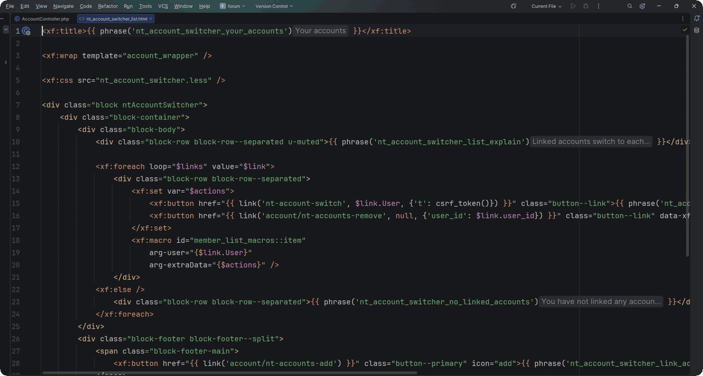
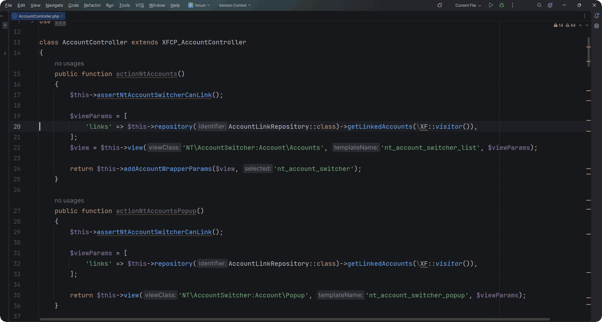
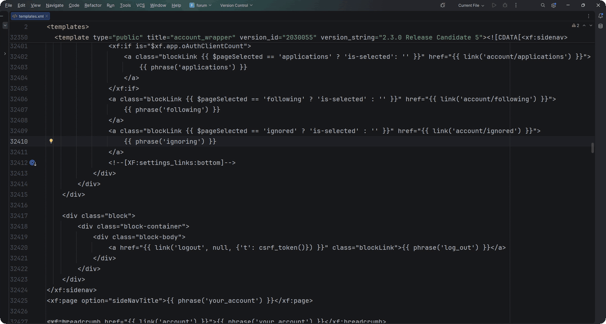
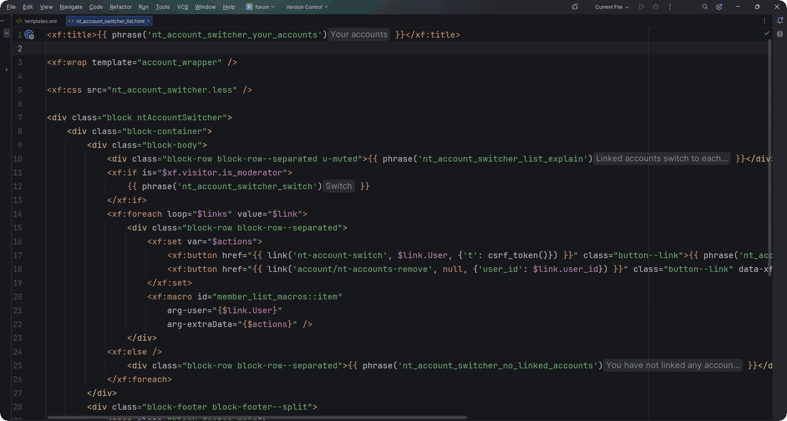

<div align="center">


# XenForo Tools

Плагин PhpStorm для разработки плагинов и стилей XenForo 2

[](https://www.jetbrains.com/phpstorm/)
[](https://xenforo.com)
[](https://github.com/mityakuss-pixel/nt-xenforo-phpstorm/releases/latest)
[](https://github.com/mityakuss-pixel/nt-xenforo-phpstorm/releases)
[](LICENSE)

**Русский** · [English](README.en.md)

<br>



</div>

<br>

Без плагина PhpStorm видит в шаблоне XenForo обычный HTML: помечает ошибками `{{ link(…) }}` в атрибутах и теги `<xf:if>`, сбивает отступы при форматировании и ничего не знает о фразах, макросах и классах `XFCP_`. XenForo Tools добавляет в IDE язык шаблонов XenForo и связывает шаблоны, фразы, модификации и PHP-код плагинов между собой.

Все имена плагин берёт из файлов форума: из `_output` ваших плагинов, из `_data` ядра и установленных плагинов и из PHP-классов. Поэтому подсказки совпадают с установленной версией XenForo, а сторонние плагины видны наравне с ядром. Разбор шаблонов проверен на всех 1198 шаблонах XenForo 2.3.

## Шаблоны

- **Синтаксис без ложных ошибок.** Теги `<xf:…>`, выражения `{{ … }}` и переменные `{$…}` подсвечены поверх HTML. HTML, CSS и JavaScript внутри шаблона работают как обычно, код в `<xf:js>` разбирается как JavaScript, а в `<xf:css>` как LESS.
- **Подсказки.** Теги с обязательными атрибутами, аргументы макросов, функции и фильтры, поля и методы `$xf.visitor`, настройки `$xf.options` с вложенными ключами. Функции и фильтры, которые ваши плагины регистрируют через `addFunction()` и `addFilter()`, тоже в списке.
- **Переходы по <kbd>Ctrl</kbd>+клику** к шаблонам, макросам, фразам, маршрутам, правам, свойствам стиля, обработчикам `data-xf-click` и `data-xf-init`, классам тегов и полям сущностей. Полный список ниже.
- **Переменные из контроллера.** Плагин находит `$this->view(…, 'шаблон', $viewParams)` и знает тип каждого параметра: после `{$thread.` подсказываются поля `XF\Entity\Thread`. Значок на первой строке шаблона ведёт к контроллеру, а <kbd>Ctrl</kbd>+клик по переменной без `<xf:set>` открывает ключ массива в `view()`.
- **Документация.** <kbd>Ctrl</kbd>+<kbd>Q</kbd> показывает текст фразы, описание настройки, атрибуты тега и параметры функции. После `{{ phrase('…') }}` серым виден текст фразы.
- **Форматирование.** <kbd>Ctrl</kbd>+<kbd>Alt</kbd>+<kbd>L</kbd> ставит отступы табами, как в шаблонах ядра. `<xf:else />` встаёт на уровень своего `<xf:if>` уже при наборе, атрибуты выравниваются по настройкам HTML.
- **Ошибки компиляции.** Незакрытые и перепутанные теги, `<xf:else />` вне `<xf:if>`, неизвестные теги, недописанные выражения и `phrase($name)` с именем из переменной подчёркиваются сразу, до запуска форума. Для `phrase($name)` <kbd>Alt</kbd>+<kbd>Enter</kbd> заменяет вызов на `phrase_dynamic($name)`.
- **Неизвестные макросы.** Если шаблон найден, а макроса с таким именем в нём нет, вызов `<xf:macro id="шаблон::макрос">` или `call_macro()` подчёркивается слабым предупреждением. Шаблоны, которых нет в проекте, и шаблоны, куда макрос может добавить модификация, не проверяются.
- **Admin-шаблоны вне админки.** XenForo компилирует admin-шаблоны только для панели управления, поэтому `<xf:include template="admin:…">` в шаблонах `public` и `email` подчёркивается.
- **Мелочи при наборе.** `{{` сам дописывает ` }}`, `>` в `<xf:foreach …>` дописывает закрывающий тег, <kbd>Ctrl</kbd>+<kbd>/</kbd> оборачивает выделение в `<xf:comment>`.

<details>
<summary><b>Где работают подсказки и переходы</b></summary>
<br>

| Где | Что открывается |
|---|---|
| `<xf:include template="…">`, `<xf:wrap>`, `<xf:extends>` | шаблон |
| `<xf:macro id="шаблон::макрос">`, `extends="…"` у макроса | шаблон и макрос в нём, при вызове подсказываются аргументы `arg-…` |
| `<xf:extension id="…">`, `<xf:extensionvalue>` | расширение в этом шаблоне или в родителе по цепочке `<xf:extends>` |
| `<xf:css src="….less">` | шаблон стилей |
| `<xf:js src="…">`, `dev="…"`, `prod="…"` | файл в `js/`, а при `addon="…"` сначала в `_files/js` плагина, как ищет сам XenForo |
| `<xf:widgetpos id="…">` | позиция виджета |
| `<xf:callback class="…" method="…">` | класс и метод PHP |
| `data-xf-init="tooltip"`, `data-xf-click="overlay"` и любое другое `data-xf-<событие>` | обработчик, зарегистрированный через `XF.Element.register` или `XF.Event.register` |
| `phrase('…')` | фраза, в подсказке виден её текст |
| `link('…')`, `link_type('…', '…')` | маршрут |
| `property('…')` | свойство стиля |
| `$xf.visitor.hasPermission('forum', '…')` | право в `_output/permissions` или `permissions.xml` |
| `$xf.visitor.username`, `$xf.visitor.canSearch()` | поле или метод PHP-класса |
| `$xf.options.boardTitle` | настройка в `options.xml` или `_output/options` |
| `<xf:avatar>`, `<xf:foreach>` и другие теги | класс тега в `XF\Template\Compiler\Tag` или в коде плагина |
| `\|escape`, `demo_badge(…)` | метод `Templater` или код плагина, где функция зарегистрирована |
| `$hasBadges` в `is="…"` и `{$…}` | `<xf:set var="…">`, `value`, `key` или `i` у `<xf:foreach>`, `arg-…` у макроса или ключ массива в `view()` контроллера |

Модификаторы в имени фразы, например `phrase('user_name:')`, плагин отбрасывает так же, как `XF\Language`, и открывает саму фразу. При переименовании файла шаблона ссылки в `template="…"` обновятся. В панели **Structure** теги `<xf:…>` показаны деревом, макросы подписаны как `xf:macro#имя`.

</details>

<details>
<summary><b>Стили LESS и CSS</b></summary>
<br>

Шаблоны `.less` и `.css` из `_output/templates` открываются как шаблоны XenForo поверх LESS и CSS: `<xf:if>`, `<xf:foreach>` и `{$…}` внутри стилей не ломают разбор.

К каждому стилю плагин подключает то же, что `XF\CssRenderer`: шаблон `public:setup.less` с вложенными шаблонами, `<префикс>_prepend.less` и всё, что подключено через `{{ include('…') }}`, `<xf:include>` и `@import`. Переменные и миксины из них, `@xf-…` и `.xf-…()` из свойств стиля и `@fa-var-…` не считаются необъявленными. <kbd>Ctrl</kbd>+клик по переменной или миксину открывает место, где они объявлены.

</details>

## PHP-код плагинов

<div align="center">

</div>

- **Классы `XFCP_…` больше не красные.** Плагин берёт расширения из `_output/class_extensions`, `_data/class_extensions.xml` и самих классов и сообщает PhpStorm, от какого класса наследуется каждое. Работают подсказки методов родителя, `parent::` и <kbd>Ctrl</kbd>+<kbd>O</kbd>. Заглушка с этими классами лежит в системной папке PhpStorm, в проект ничего не пишется.
- **Короткие имена классов.** `'XF:User'` в `finder()`, `em()->find()`, `repository()`, `service()`, `plugin()`, `enqueue()` и других фабриках подсказывается и открывает класс, как его найдёт `XF::stringToClass`. <kbd>Alt</kbd>+<kbd>Enter</kbd> заменяет короткое имя на класс, например `\XF\Entity\User::class`, там, где класс передаёт и само ядро XF 2.3. В `view()`, `behaviors` и `shortName` остаются короткие имена, как в ядре.
- **Колонки сущностей.** В `where('…')`, `order('…')`, `with('…')` и `$entity->get('…')` подсказываются колонки, связи и геттеры, в том числе пути вида `User.username` и колонки, которые добавляют расширения и слушатели `entity_structure`.
- **Имена XenForo в строках.** `\XF::phrase('…')`, `$this->view(…, '…')`, `renderTemplate('public:…')`, `buildLink('…')` и `hasPermission('…', '…')` подсказывают и открывают фразы, шаблоны, макросы, маршруты и права. После фразы серым виден её текст. Если в контроллере или представлении из `Pub` или `Api` вызван `admin:`-шаблон, вызов подчёркивается.
- **Контейнер приложения.** <kbd>Ctrl</kbd>+клик по ключу в `\XF::app()->container('…')`, `$app['…']` и `$container['…']` открывает место, где ключ задан: в ядре или в коде плагина, например в слушателе `app_setup`.
- **Расширение класса.** Правый клик на классе XF или другого плагина, пункт **Extend Class in XenForo Add-on…**, создаёт расширение и регистрирует его. Тот же пункт есть у PHP-файла класса в дереве проекта и в <kbd>Alt</kbd>+<kbd>Enter</kbd>.
- **Проверка ответа контроллера.** <kbd>Alt</kbd>+<kbd>Enter</kbd> на `return parent::actionIndex($params);` оборачивает ответ в проверку `$reply instanceof \XF\Mvc\Reply\View`.
- **Версия PHP плагина.** Если `require.php` в `addon.json` не совпадает с уровнем PHP проекта, над PHP-файлами плагина появляется плашка с кнопкой переключения. Уровень в PhpStorm один на весь проект, поэтому кнопка меняет его целиком. Тот же переход есть в меню плагина, а в **Settings → PHP → XenForo** можно включить автоматическое переключение при переходе на файл плагина.
- **Скоупы плагинов.** Для каждого плагина с `_output` есть готовый скоуп «XenForo: Vendor/AddOn»: по нему можно искать и заменять, раскрашивать файлы и включать проверки.
- **Setup.php.** Рядом с `installStep1()`, `upgrade1000170Step2()` и `uninstallStep1()` стоит значок запуска: шаг выполняется отдельно через `xf-addon:install-step`, `upgrade-step` или `uninstall-step`.
- **JSON в `_output`.** Классы и методы в расширениях, слушателях событий, маршрутах, задачах cron, виджетах и настройках открываются по <kbd>Ctrl</kbd>+клику. `addon.json` и `build.json` проверяются по схеме: неизвестный ключ или пропущенный `version_id` подчёркивается.

## Модификации шаблонов

<div align="center">

</div>

- Выделите фрагмент в шаблоне или в `templates.xml` ядра и выберите в контекстном меню **Create XenForo Template Modification…**. Плагин подставит шаблон, плагин и `find`, проверит, сколько раз фрагмент встречается в шаблоне, и создаст модификацию через `xf-make:template-modification`.
- Значок на полях шаблона и `templates.xml` показывает, какие модификации каких плагинов меняют строку. По клику открывается модификация.
- Если после обновления XenForo `find` больше не находится в шаблоне, JSON модификации подчёркивается.

## Фразы

<div align="center">

</div>

- Фраза, которой нет ни в `_output`, ни в `_data`, подчёркивается в `phrase('…')` шаблона и в `\XF::phrase('…')` PHP. <kbd>Alt</kbd>+<kbd>Enter</kbd> создаёт её в выбранном плагине.
- <kbd>Alt</kbd>+<kbd>Enter</kbd> на тексте шаблона заменяет его на `{{ phrase('…') }}` и создаёт фразу. Название собирается из префикса плагина и текста, русский текст переводится в латиницу.

Проверка включается, когда в проекте есть фразы ядра `src/addons/XF/_data/phrases.xml`.

## Команды плагина

Правый клик по папке плагина или по любому файлу в ней открывает меню **XenForo: Vendor/AddOn**. Оно же есть в меню вкладки редактора и в **Tools**.

| Пункт | Команда |
|---|---|
| Build Release | `xf-addon:build-release`, по готовности приходит уведомление со ссылкой на архив |
| Bump Version… | `xf-addon:bump-version`, `version_id` считается из строки версии, в том числе из `RC 2` и `Patch 1` |
| Export / Import Development Output | `xf-dev:export` и `xf-dev:import` для этого плагина |
| Export _data XML | `xf-addon:export` |
| Sync addon.json to Database | `xf-addon:sync-json` |
| XenForo Artifact (xf-make)… | сущность, контроллер, маршрут, шаблон, слушатель и всё, что умеет `xf-make` вашей версии. Пункт есть и в **File → New** |
| Extend Class… | `xf-make:extension` |
| Lint Templates | `xf-dev:lint-templates`, ошибки в выводе ведут к шаблону и строке |
| Find Unused Phrases | `xf-dev:unused-phrase-finder` |
| Update Entity @property Docblocks | `xf-dev:entity-class-properties` для всех сущностей плагина, а на файле сущности только для неё |
| Check Classes Load | `xf-dev:class-lint` |
| Generate .phpstorm.meta.php | `xf-dev:generate-phpstorm-meta` |
| Generate Options Stub | `xf-dev:generate-options-stub` |
| Run cmd.php Command… | любая команда `cmd.php`, последняя запоминается |

Пункты, для которых в вашей версии XenForo нет команды, не показываются. В XenForo 2.2 нет команд `xf-make`, и там плагин сам пишет файл в `_output` и запускает импорт `xf-dev:import-…`.

Вывод идёт в окно **Run**, где команду можно остановить или запустить заново. Команды запускает интерпретатор PHP проекта. Если форуму нужна другая версия PHP, её можно выбрать в **Settings → PHP → XenForo**, подходят и удалённые интерпретаторы: Docker, WSL, SSH. Там же указывается папка форума с `cmd.php`, если плагин лежит отдельно и подключён симлинком.

## Установка

Нужен PhpStorm 2026.2 или новее.

1. Скачайте `nt-xenforo-phpstorm-<версия>.zip` со [страницы релизов](https://github.com/mityakuss-pixel/nt-xenforo-phpstorm/releases/latest). Распаковывать архив не нужно.
2. Откройте **Settings → Plugins** (<kbd>Ctrl</kbd>+<kbd>Alt</kbd>+<kbd>S</kbd>, на macOS <kbd>⌘</kbd>+<kbd>,</kbd>), нажмите на шестерёнку и выберите **Install Plugin from Disk…**
3. Укажите архив и перезапустите PhpStorm, если он попросит.

Откройте в PhpStorm всю папку форума, а не один плагин: тогда в подсказках будут шаблоны, фразы и классы ядра. Шаблонами считаются файлы `*.html`, `*.less` и `*.css` из `_output/templates/public`, `admin` и `email`, у их вкладок появится фиолетовая иконка `{$}`. В проектах без таких папок плагин ничего не меняет.

Обновление ставится так же, поверх старой версии. Удаление: **Settings → Plugins → Installed → XenForo Tools → Uninstall**.

## Горячие клавиши

| Клавиши | Что делают |
|---|---|
| <kbd>Ctrl</kbd>+<kbd>Space</kbd> | подсказка в любом месте шаблона |
| <kbd>Ctrl</kbd>+клик, <kbd>Ctrl</kbd>+<kbd>B</kbd> | переход к шаблону, макросу, фразе, маршруту, полю или функции |
| <kbd>Ctrl</kbd>+<kbd>Q</kbd> | документация по фразе, настройке, тегу или функции |
| <kbd>Ctrl</kbd>+<kbd>P</kbd> | параметры функции, фильтра или метода |
| <kbd>Ctrl</kbd>+<kbd>Alt</kbd>+<kbd>L</kbd> | форматирование шаблона |
| <kbd>Ctrl</kbd>+<kbd>/</kbd> | закомментировать строку или выделение через `<xf:comment>` |
| <kbd>Alt</kbd>+<kbd>Enter</kbd> | создать фразу, вынести текст в фразу, расширить класс, проверить ответ контроллера |

На macOS вместо <kbd>Ctrl</kbd> нажимайте <kbd>⌘</kbd>.

## Настройки

| Что | Где |
|---|---|
| Отступы, по умолчанию табы | Settings → Editor → Code Style → XenForo Template |
| Цвета | Settings → Editor → Color Scheme → XenForo Template |
| Проверки тегов, фраз, модификаций и admin-шаблонов | Settings → Editor → Inspections → XenForo |
| Текст фразы после `phrase()` и `\XF::phrase()` | Settings → Editor → Inlay Hints, пункт **Phrase text** |
| PHP и папка форума для команд | Settings → PHP → XenForo |
| Другие файлы как шаблоны | Settings → Editor → File Types → XenForo Template |

## Ограничения

- Шаблоны и фразы, которые есть только в панели управления, а не файлами, плагину не видны. Такие фразы проверка считает неизвестными.
- Колонки, которые `getStructure()` или слушатель `entity_structure` добавляют в цикле или под вычисленным именем, не подсказываются.
- Переменные шаблона берутся из `view()`, где параметры заданы массивом или переменной в том же методе контроллера.
- Имена из переменных, например в `phrase_dynamic($name)`, не проверяются и не подсказываются.
- Командам нужна рабочая база форума, а `xf-dev:export` и `xf-dev:import` работают только в режиме разработки, включённом в `config.php`.

## Сборка из исходников

Нужен JDK 25.

```shell
./gradlew buildPlugin
```

Архив появится в `build/distributions`, тесты запускаются командой `./gradlew test`.

## Лицензия

[MIT](LICENSE)
