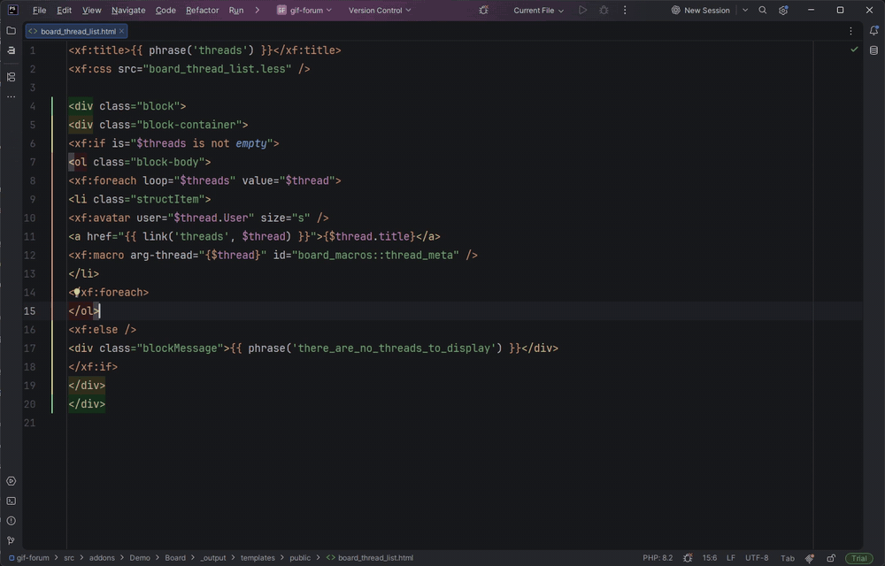

<div align="center">


# XenForo Templates

Плагин для PhpStorm, который понимает шаблоны XenForo 2. Подсвечивает `<xf:…>`, `{{ … }}` и `{$…}`, подсказывает теги, функции и фразы, по Ctrl+клику открывает шаблоны и макросы, расставляет отступы и находит ошибки, на которых шаблон не скомпилируется.

[](https://www.jetbrains.com/phpstorm/)
[](https://xenforo.com)
[](https://github.com/mityakuss-pixel/nt-xenforo-phpstorm/releases/latest)
[](https://github.com/mityakuss-pixel/nt-xenforo-phpstorm/releases)
[](LICENSE)

**Русский** · [English](README.en.md)



</div>

## Для кого

Плагин нужен разработчикам плагинов и стилей XenForo, которые правят шаблоны в PhpStorm в режиме разработки, когда шаблоны лежат файлами в `_output`.

Без плагина PhpStorm видит в шаблоне обычный HTML. Он помечает ошибками `{{ link(…) }}` в атрибутах и теги `<xf:if>`, при форматировании сбивает отступы и не знает имён шаблонов, фраз и функций XenForo.

## Возможности

### Синтаксис без ложных ошибок

Теги `<xf:…>`, выражения `{{ … }}` и переменные `{$…}` подсвечены поверх HTML, а HTML, CSS и JavaScript внутри шаблона работают как обычно. `{{ link(…) }}` в атрибутах, `<xf:if>` внутри разметки и ветки `<xf:else />`, где открывается разный HTML, ошибок не дают. Плагин проверен на всех 1082 HTML-шаблонах XenForo 2.3.

### Подсказки

- Теги `<xf:…>` с обязательными атрибутами: после выбора `if` вставится `<xf:if is=""></xf:if>`, курсор встанет в кавычки.
- Атрибуты того тега, внутри которого стоит курсор.
- Функции шаблонов с параметрами, фильтры после `|`, тест `is empty`.
- Переменные, которые встречаются в шаблоне и аргументах макроса, ключи `$xf.visitor`, `$xf.options` и другие.

### Переходы по проекту

Плагин знает шаблоны, макросы, фразы, маршруты и свойства стиля из `_output` ваших плагинов и из `_data` ядра и установленных плагинов XenForo. Имена подсказываются и открываются по Ctrl+клику в таких местах:

| Где | Что |
|---|---|
| `<xf:include template="…">`, `<xf:wrap>`, `<xf:extends>` | шаблон |
| `<xf:macro id="шаблон::макрос">` | шаблон и макрос в нём |
| `<xf:css src="….less">` | шаблон стилей |
| `phrase('…')` | фраза, в подсказке виден её текст |
| `link('…')`, `link_type('…', '…')` | маршрут |
| `property('…')` | свойство стиля |

При переименовании файла шаблона ссылки на него в `template="…"` обновятся.

### Форматирование

<kbd>Ctrl</kbd>+<kbd>Alt</kbd>+<kbd>L</kbd> расставляет отступы табами, как в шаблонах ядра. `<xf:else />` и `<xf:elseif />` встают на уровень своего `<xf:if>`:

```html
<xf:if is="$threads is not empty">
	<ol class="block-body">
		<xf:foreach loop="$threads" value="$thread">
			<li>{$thread.title}</li>
		</xf:foreach>
	</ol>
<xf:else />
	<div class="blockMessage">{{ phrase('there_are_no_threads_to_display') }}</div>
</xf:if>
```

### Ошибки компиляции

Плагин отмечает то, на чём XenForo не скомпилирует шаблон: незакрытые и перепутанные теги, `<xf:else />` вне `<xf:if>`, `<xf:elseif />` после `<xf:else />`, неизвестные теги и недописанные выражения.

### Мелочи при наборе

- `{{` сам дописывает ` }}`, кавычка в выражении закрывается парой.
- `>` в открывающем теге `<xf:foreach …>` дописывает `</xf:foreach>`.
- Enter между открывающим и закрывающим тегом раскрывает пустой блок.
- <kbd>Ctrl</kbd>+<kbd>/</kbd> оборачивает выделение в `<xf:comment>`, длинные блоки сворачиваются.

## Установка

1. Скачайте `nt-xenforo-phpstorm-1.0.0.zip` со [страницы релизов](https://github.com/mityakuss-pixel/nt-xenforo-phpstorm/releases/latest). Архив распаковывать не нужно.
2. В PhpStorm откройте настройки: <kbd>Ctrl</kbd>+<kbd>Alt</kbd>+<kbd>S</kbd>, на macOS <kbd>⌘</kbd>+<kbd>,</kbd>.
3. Перейдите в **Plugins**, нажмите на шестерёнку справа от вкладок и выберите **Install Plugin from Disk…**
4. Укажите скачанный архив и нажмите **OK**. Если PhpStorm предложит перезапуск, согласитесь.

**Проверка.** Откройте любой шаблон из `src/addons/<плагин>/_output/templates/public`. У вкладки появится фиолетовая иконка `{$}`, а теги `<xf:…>` и выражения `{{ … }}` подсветятся.

**Обновление.** Скачайте новый архив и установите его так же, поверх старой версии.

**Удаление.** **Settings → Plugins → Installed → XenForo Templates → Uninstall.**

## Как плагин находит шаблоны

Шаблонами XenForo считаются файлы `*.html` из папок `_output/templates/public`, `admin` и `email`, их не нужно настраивать. Чтобы так же открывались другие файлы, добавьте их маску в **Settings → Editor → File Types → XenForo Template**.

Имена для подсказок и переходов плагин собирает из `_output` (фразы, шаблоны, маршруты, свойства стиля) и из `_data/*.xml`. Поэтому в PhpStorm лучше открывать всю папку форума, а не один плагин: тогда в подсказках будут и имена из ядра XenForo.

## Горячие клавиши

| Клавиши | Что делают |
|---|---|
| <kbd>Ctrl</kbd>+<kbd>Space</kbd> | подсказка в любом месте шаблона |
| <kbd>Ctrl</kbd>+клик, <kbd>Ctrl</kbd>+<kbd>B</kbd> | переход к шаблону, макросу, фразе или маршруту |
| <kbd>Ctrl</kbd>+<kbd>Alt</kbd>+<kbd>L</kbd> | форматирование шаблона |
| <kbd>Ctrl</kbd>+<kbd>/</kbd> | закомментировать строку или выделение через `<xf:comment>` |

На macOS вместо <kbd>Ctrl</kbd> нажимайте <kbd>⌘</kbd>.

## Настройки

| Что | Где |
|---|---|
| Отступы, по умолчанию табы | Settings → Editor → Code Style → XenForo Template |
| Цвета | Settings → Editor → Color Scheme → XenForo Template |
| Проверка неизвестных тегов | Settings → Editor → Inspections → XenForo |

## Ограничения

- Шаблоны `.less` и `.css` открываются как обычные стили.
- Функции и фильтры, которые плагины XenForo добавляют в код, в подсказках не появятся, но и ошибкой не подчёркиваются.
- Шаблоны, которые правятся в панели управления, а не файлами, плагину не видны.

## Сборка из исходников

Нужен JDK 25.

```shell
./gradlew buildPlugin
```

Архив появится в `build/distributions`. Тесты запускаются командой `./gradlew test`.

## Лицензия

[MIT](LICENSE)
